# NTE Autoguitar

基于 [Flet](https://flet.dev) 的吉他谱工具。目前有六个页面：**GTAB 编辑**（读取 / 编辑 / 写回 `.gtab` 文件，含试听）、**GCT 编辑**（和弦谱的读取 / 编辑 / 写回，含和弦指法核对）、**手柄映射**（`.gtab` / `.gct` 谱面 → 虚拟手柄的可行性与时序验证）、**MIDI 映射**（MIDI 文件 → 键盘按键，按时间发进游戏）、**MIDI→GTAB**（把 MIDI 排成手柄能弹的 `.gtab`）和 **设置**（两个全局开关 + 版本号：事件 CRC / MIDI 八度投影）。

鼠标弹奏在游戏里不稳定（时序不可控、也容易丢音），所以本项目舍弃了键鼠方案，
改用虚拟手柄（Xbox 360 控制器）来触发游戏里的音符；另有一条 **MIDI → 键盘** 的
备用路径（`SendInput` + 扫描码），给只认键盘的游戏用。

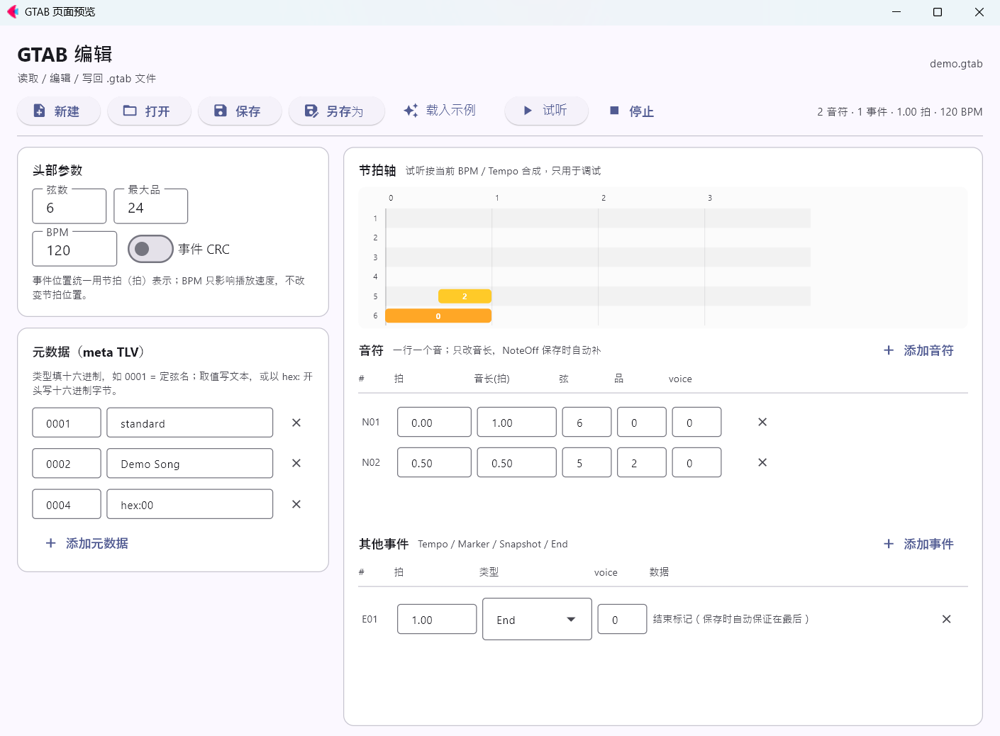

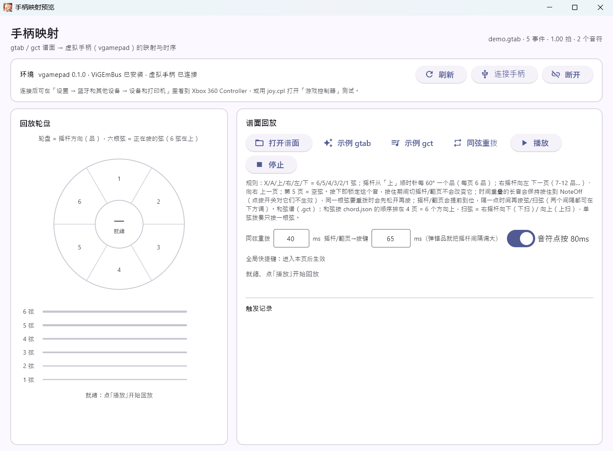

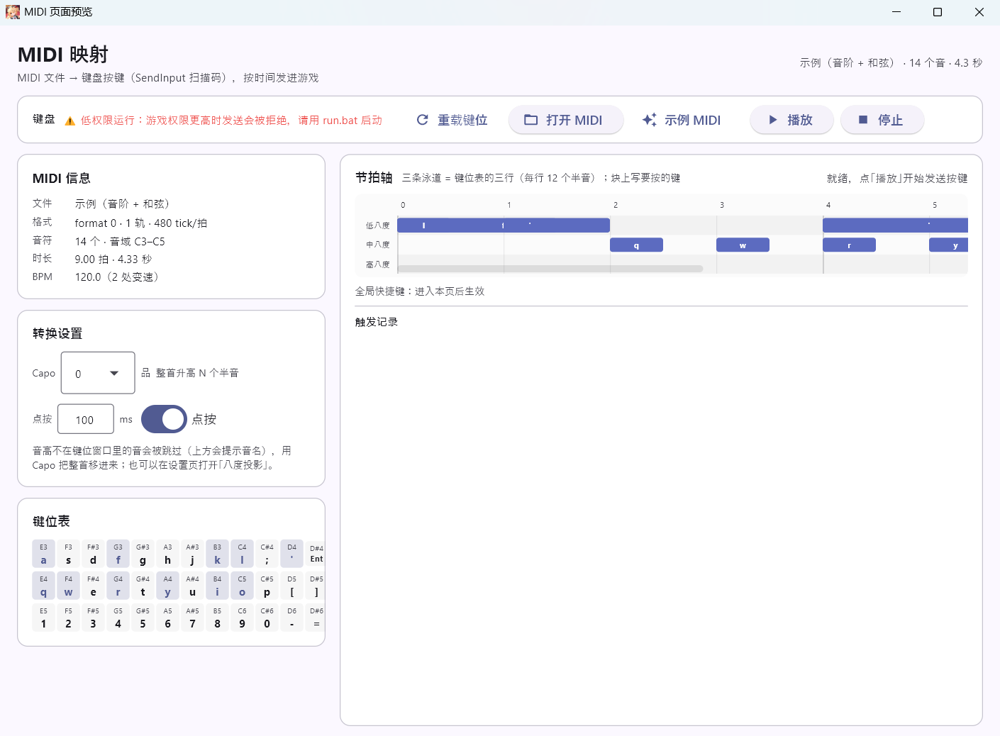

## 安装与运行

要求 **Windows 10/11**（手柄页依赖 ViGEmBus 驱动，试听用 `winsound`，全局热键用
`RegisterHotKey`，MIDI 页用 `SendInput`，截图脚本用 DWM API）和 **Python 3.10+**（开发环境是 3.14.7）。

```powershell
git clone <本仓库地址> NTE-Autoguitar
cd NTE-Autoguitar
python -m venv .venv
.venv\Scripts\python.exe -m pip install -r requirements.txt
```

依赖（`requirements.txt`）：`flet==1.0.4`、`flet-desktop==1.0.4`、`vgamepad==0.1.0`。
`vgamepad` 还需要一次性安装 **ViGEmBus** 驱动（装完确认 Windows 服务 `ViGEmBus` 在运行）：
下载安装包 <https://github.com/nefarius/ViGEmBus/releases> ，装完重启一次即可。

**推荐双击 `run.bat`**（普通权限）启动。如果游戏以管理员运行、或热键在游戏前台不生效，
改用 **`run_admin.bat`**（会弹 UAC；本次实测管理员启动后热键正常）。也可以在普通终端里运行：

```powershell
.venv\Scripts\python.exe main.py
```

> 不要从低权限进程（沙盒终端、CI、部分 IDE 的运行器）启动：那会是 Low integrity 进程，
> 游戏在前台时全局热键收不到（见「排错」）。

## 目录结构

```
main.py                  入口，只负责启动
run.bat                  普通权限启动（全局热键需要）
run_admin.bat            管理员启动（游戏以管理员运行时用）
build_release.ps1        打包 exe（flet pack / PyInstaller；资源约定见 src/paths.py）
requirements.txt         运行依赖（flet / flet-desktop / vgamepad）
.gitignore               排除 .venv、__pycache__、开发交接笔记、临时 wav
AGENTS.md                给接手 AI 的接手指引（文档地图 + 检查点位置 + 必守约束）
checkpoint/              AI 交接检查点：所有 checkpoint-*.md 都在这里（本地保留，不进版本库）
LICENSE                  MIT
src/
  app.py                 主 GUI 外壳：左侧导航 + 页面容器
  example.py             用 GtabWriter 生成示例谱 demo.gtab 的小脚本
  gtab.py                gtab 二进制格式的底层读写
  gct.py                 gct（和弦谱）二进制格式的底层读写
  midi.py                标准 MIDI 文件（SMF）的最小读写（只用标准库）
  version.py             程序版本号（唯一来源，设置页显示）
  branding.py            窗口图标路径（docs/AkaneRin.ico，主壳与预览脚本共用）
  paths.py               运行路径：源码运行 vs 打包运行（资源根 / %APPDATA% 设置）
  chord.json             24 个和弦名（顺序 = 手柄上的位置）+ CHORDS_MAPPINGS 指法表
  midi_keys.json         MIDI → 键盘的键位表（BASE_NOTE=52 + 36 个键，E3–D#6，运行时读取）
  settings.json          两个全局开关（设置页写出来；本地偏好，已在 .gitignore）
  ui/
    gtab_doc.py          gtab 文档模型：解析 / 校验 / 序列化（无界面依赖）
    gct_doc.py           gct 文档模型：和弦事件 / 和弦表 / Tempo（无界面依赖）
    midi_doc.py          MIDI 文档模型：音符配对 / 拍与秒换算（含 tempo 变化）
    midi_to_gtab.py      MIDI → GTAB 转换：定弦 / 页面 / tempo / 同键重叠（纯逻辑）
    settings.py          全局设置模型：AppSettings / 读写 settings.json / force_event_crc
    chords.py            和弦名 → 第几页 + 第几个方向；指法表（-1 = 不发声，界面显示 x）
    audio_preview.py     试听合成：音符 → 16-bit WAV（只用标准库）
    chord_preview.py     和弦试听：gct 事件 → 扫弦/拨奏音符 → WAV（复用上面的合成器）
    gamepad_backend.py   虚拟手柄封装 + 谱面 → 按键排期（纯函数可测）
    gct_backend.py       和弦谱 → 多根弦的扫弦/拨奏排期（复用同一套时序）
    keyboard_backend.py  MIDI → 键盘：键位表校验 / 按键排期 / SendInput 扫描码
    replay_view.py       手柄页左侧的「回放轮盘」：摇杆方向（品/和弦）+ 六根弦
    hotkeys.py           全局热键（F9 播放 / F10 停止，Windows RegisterHotKey）
    components.py        跨页面复用的小控件
    pages/
      gtab_page.py       GTAB 编辑页
      gct_page.py        GCT 编辑页（节拍轴 / 和弦事件 / Tempo / 和弦表）
      gamepad_page.py    手柄映射页（回放 + 轮盘 + 时序）
      midi_page.py       MIDI 映射页（信息 / Capo / 键位表 / 节拍轴 / 发送）
      midi_to_gtab_page.py  MIDI→GTAB 页（载入 / 预览 / 保存 / 送 GTAB 编辑页）
      settings_page.py   设置页（两个全局开关 + 版本号，改完立即写盘）
      placeholder.py     占位页（目前没有页面在用，留给以后新增页）
tests/
  test_gtab_doc.py       模型层测试（含音长 / 自动 NoteOff / 试听时间轴）
  test_gtab_page.py      页面构建测试（音符视图、音长编辑、孤立 NoteOff）
  test_audio_preview.py  试听合成测试（频率 / WAV / BPM / Tempo / 和弦弦序）
  test_gamepad_mapping.py  谱面 → 按键排期测试
  test_replay_view.py    回放轮盘测试（扇区映射 / 状态推进 / 回放接线）
  test_gct_doc.py        gct 格式测试（读写往返 / CRC / Tempo / 缺 End）
  test_gct_mapping.py    和弦表 + gct → 扫弦排期测试
  test_gct_page.py       手柄页 gct 回放测试（载入 / 计数 / 上扫顺序 / 复位 / 热键不自动连接）
  test_gct_editor.py     GCT 编辑页 + chord.json 指法表测试（-1 → x / 事件编辑 / 节拍轴 / 试听）
  test_gct_file_ops.py   GCT 页文件操作测试（假 FilePicker：打开 / 保存 / 另存为 / 取消）
  test_hotkeys.py        全局热键测试（F24 注册 + 消息派发）
  test_midi_doc.py       MIDI 测试（SMF 解析 / tempo 换算 / 键位表 / Capo / 排期 / 页面离线）
  test_midi_to_gtab.py   MIDI→GTAB 转换测试（定弦 / 只留最高 / 把位 / tempo / 重叠 / 回读）
  test_midi_to_gtab_page.py  MIDI→GTAB 页面构建测试（默认开关 / 示例转换 / 送编辑页）
  test_settings.py       设置测试（默认值 / JSON 往返容错 / 全局 CRC / 保存后重读 / 版本号 / 八度投影）
  preview_gtab_page.py   开发用：单独预览 GTAB 页
  preview_gct_page.py    开发用：单独预览 GCT 编辑页
  preview_gamepad_page.py 开发用：单独预览手柄映射页（PREVIEW_SCORE=gct 看和弦谱）
  preview_midi_page.py   开发用：单独预览 MIDI 映射页
  preview_midi_to_gtab_page.py 开发用：单独预览 MIDI→GTAB 页（PREVIEW_STATE=keepall 看和弦）
  preview_settings_page.py 开发用：单独预览设置页（PREVIEW_STATE=on 看两个开关都打开的样子）
  preview_replay_wheel.py 开发用：单独预览回放轮盘
  capture_gtab_screenshot.ps1 开发用：重拍界面截图（DPI 感知）；-Page gtab|gct|gamepad|midi|midi2gtab|settings|wheel，-Out 指定文件
```

预览脚本的开关（截图脚本会继承环境变量）：

| 环境变量 | 作用 |
|---|---|
| `PREVIEW_WIDTH` / `PREVIEW_HEIGHT` | 窗口逻辑尺寸；App 内容宽度是 **1144**（1280 减导航栏 96 与分隔线） |
| `PREVIEW_SCORE=gtab\|gct` | 手柄页载入单音谱还是和弦谱；gct 时默认存 `docs/gamepad_gct.png` |
| `PREVIEW_STATE=play` | 手柄页摆成「和弦扫到一半」；GTAB / GCT 页摆成「试听中」；MIDI 页摆成「发送中」（都只摆状态，不播音 / 不发按键） |
| `PREVIEW_STATE=keepall` | MIDI→GTAB 页关掉「只留最高音」，截图里能看到和弦的全部音 |
| `PREVIEW_STATE=on` | 设置页把两个开关画成打开的样子（只改控件，不写 `settings.json`） |
| `PREVIEW_PAGE=4` | 用最后一页的和弦（名字最长）当示例 |
| `PREVIEW_SCALE=1.6` | 轮盘预览（`-Page wheel`）整体放大，核对和弦名会不会顶出外圈 |

例：`$env:PREVIEW_WIDTH='1144'; $env:PREVIEW_SCORE='gct'; pwsh -File tests/capture_gtab_screenshot.ps1 -Page gamepad`

## 加一个新页面

1. 在 `src/ui/pages/` 下写一个类，提供 `build() -> ft.Control`；
2. 在 `src/app.py` 的 `entries` 里加一行 `(标题, 图标, 页面控件)`。

## gtab 事件里的 voice

NoteOn / NoteOff 的事件头里固定有一个 1 字节 `voice`（默认 `0`，界面里可改 0–255）。
**格式本身没有规定它代表什么**，本项目只把它当「声部号」用：`note_blocks()` 按
`(voice, 弦, 品)` 把 NoteOn / NoteOff 配成一个个音。所以同一对 On/Off 必须用同一个
`voice`；手柄回放不读它，只读配对后的弦、品和起止 tick。

NoteOn / NoteOff 行里的三个数字：

| 输入 | 含义 |
|---|---|
| `voice` | 事件头 1 字节声部号，默认 0；只参与配对，不决定音高 |
| `弦` | 1–6 弦，决定按哪个键（6→X、5→A、4→上、3→右、2→左、1→下） |
| `品` | 0–24 品；0 = 空弦（第 5 页），其余决定摇杆方向和翻页 |

配对键是 `(voice, 弦, 品)`，三者都对上才会把 On/Off 合成一个音；配不上的 NoteOn
按 1/4 拍占位。

## 音符与音长（NoteOff 自动维护）

GTAB 编辑页的音符区**一行就是一个音**，不再把 NoteOn / NoteOff 拆成两行：

| 列 | 含义 |
|---|---|
| `拍` | 起点（拍）；改它会 On/Off 一起移动，音长不变 |
| `音长(拍)` | 音的长度；改它会自动移动这条音对应的 NoteOff |
| `弦` / `品` / `voice` | 改任一项都会同时改 NoteOn 和 NoteOff（否则配不上） |

- **保存 / 写入时自动补 NoteOff**：读到只有 NoteOn、没有 NoteOff 的谱（手工或旧工具
  留下的），保存时会按 **1/4 拍**补一个 NoteOff；想更长就在「音长」里改。
  文件里的 NoteOff 仍然照常保留，只是界面上不单独显示。
- **同一个 `(voice, 弦, 品)` 不能重叠**：改音长时会被自动夹到下一个同键音的起点之前
  （输入框会显示真实音长）；如果还是重叠，保存会明确报错，而不是写出坏文件。
- **孤立 NoteOff 不会被静默删除**：会话里把某个事件改成 NoteOff、却找不到配对的 NoteOn 时，
  它会显示在「其他事件」里并标红，保存会拒绝并指出位置——请删掉它或把对应的音补成完整音符。
  （含孤立 NoteOff 的**文件**在严格读取阶段就会打不开，不会静默丢事件。）
- 「添加音符」在最后一个音之后的整拍上加一个 **1 拍**的音（6 弦空弦）。

## 试听（调试用）

GTAB 编辑页工具栏、GCT 编辑页「和弦事件」标题栏的「试听 / 停止」按**当前写入的内容**
合成并播放音乐，用于核对音高、节奏、音长和 BPM 是否符合预期：

- 合成只用标准库：标准定弦 `E2=82.41 / A2=110 / D3=146.83 / G3=196 / B3=246.94 / E4=329.63`，
  0 品 = 空弦，每品 +1 半音；基频加少量谐波 + 指数衰减，混音后归一化成
  16-bit 单声道 WAV（22.05 kHz）；
- 时间轴用 `tick_to_seconds()`，**BPM 和 Tempo 事件都会算进去**；开头留 0.15s、
  结尾留 0.35s，最长合成 120 秒；
- 播放用 Windows 自带的 `winsound`：`winsound` 不支持「内存 WAV + 异步播放」同时使用，
  所以先写到系统临时目录的 `.wav` 再异步播放，停止 / 播完自动删除；节拍轴上有一条红色
  播放游标，工具栏显示已播 / 总时长；
- 「停止」、载入新谱、切到别的页面都会停掉试听并清空播放队列；
- 播放时时间轴会**自动横向跟随**游标，长谱也不会让红线走出可视区；
- 试听是**调试音色**，不是最终音源；要换音色改 `src/ui/audio_preview.py` 顶部的
  谐波 / 衰减常量即可。

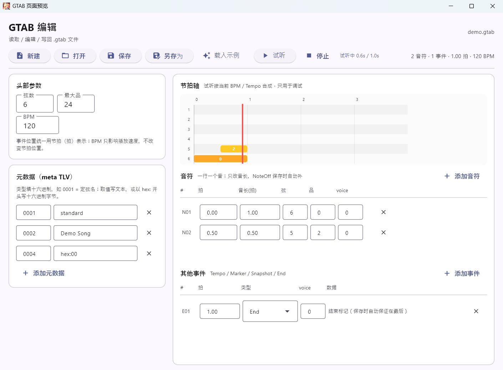

### 和弦谱的试听（GCT 页）

gct 里**没有音长**，所以和弦试听（`src/ui/chord_preview.py`）用一套自己的规则：

- 音高取自 `chord.json` 的 `CHORDS_MAPPINGS`（1 弦 → 6 弦、`-1` = 不发声）；
- **扫弦**：六根弦依次响，每根隔 `STRUM_GAP=20ms`；**下扫 6 → 1 弦、上扫 1 → 6 弦**
  （和游戏里扫弦方向一致）；**单弦拨奏**只发那一根；`Set`（只换指位）不出声；
- 一个和弦响多久由 `RING_SECONDS=0.8s` 定（文件里没有音长），相邻和弦会自然叠一点；
- 时间换算走 `gct_doc.tick_to_seconds`（gct 的 Tempo 事件是 `0x04`，BPM 与 Tempo 都算进去）；
- 表里**没有指法**的和弦会被跳过，点试听时会用提示条报出来；一个能响的都没有则不播。
  这也是「指法没填」会影响试听、但**不影响手柄回放位置**的原因；
- 试听时节拍轴上同样有红色游标 + 「试听中 x/y」进度，停止 / 载入新谱 / 切页都会停掉。

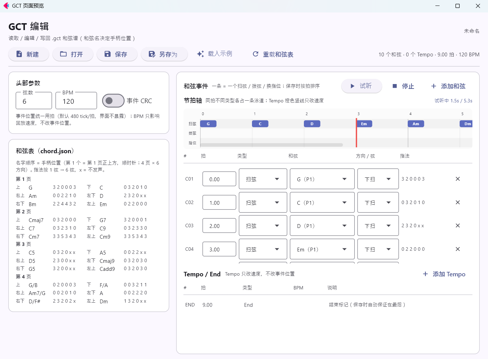

> 实现注意：WAV 合成在后台线程（`page.run_thread`），进度/游标刷新由页面事件循环里的
> async ticker（`page.run_task`）推进。**不要在后台线程里直接 `page.update()`**——
> 实测那样不会重绘（红线不出现、进度文字停在「正在合成…」）。

## 手柄映射

映射规则集中在 `src/ui/gamepad_backend.py` 顶部，改常量即可，页面和时序逻辑不用动：

| 输入 | 含义 |
|---|---|
| `X` / `A` / 十字键`上` / `右` / `左` / `下` | 6 / 5 / 4 / 3 / 2 / 1 弦（`STRING_BUTTONS`） |
| 左摇杆：`上` 起顺时针每 60° | 当前页的 1–6 品（`fret_direction`） |
| `右摇杆` 下 / 上 | **gct 扫弦：下扫 / 上扫**（不再依次按 6 个弦键） |
| `右摇杆` 左 / 右 | 下一页 / 上一页（gtab / gct 共用；一次推 = 一页） |
| 第 5 页（`OPEN_PAGE`） | 六个方向全为空弦 |

回放时的行为：

- 每个音符先确认页号，需要时用**右摇杆向左（下一页）/ 向右（上一页）推一次翻一页**
  （提前 `PAGE_LEAD` 完成，推完回中），再把左摇杆转到对应品，
  **隔 `AIM_GAP`（默认 65ms）再按弦**——同一帧里切摇杆 + 按弦时，
  游戏可能先处理按键、弹成上一个品（50ms 实测仍偶发，65ms 稳定）。摇杆方向没变时
  不重复移动、也不多等；
- 如果前一个音按得太近、或翻页占满了时间，按弦会**最多推迟到下一个音开始前**来补足间隔；
  补不足时在 ℹ 提示里写明实际间隔（毫秒）。手柄页的「摇杆→键ms」可直接调（0–300ms）；
- 开场有 `LEAD_IN=0.5s` 的预备时间，够初始翻页；
- **时间上与其他音重叠的音**（比如一边按住 6 弦空弦、一边弹 5 弦）会
  **一直按住到自己的 NoteOff**：摇杆照常切到新音需要的品，原来的弦不松手；
  这条优先于点按开关，否则长音会在重叠处被掐断；
- **游戏在按下那一刻就锁定这个音，按住期间切摇杆/翻页都不会改变它**
  （真机确认）——所以「保持按住 + 切摇杆」是正常演奏方式，不是冲突；
- 同一根弦上还没松手就要拨下一个音时，会在新音前 `REPLUCK_GAP` 先松开再按下
  （默认 40ms，实测稳定；10ms 会短于游戏一帧，不稳定）。手柄页的「重拨间隔」可直接调；
- 「音符点按 80ms」开关：开着是点按（大多数游戏按下即触发），关掉则按
  NoteOff 时长按住；点按只用于**不重叠**的音；
- 页面上的提示分两级：
  - ⚠ **冲突**（可能导致弹错）：翻页次数太多来不及、弦没有映射到按键；
  - ℹ **提示**（预期处理，不算错）：重叠时换摇杆、同一根弦松开重拨。
- 「同弦重拨」按钮会在内存里生成一张测试谱（6 弦 1 品 0–2 拍 → 3 品 1–3 拍），
  用来验证游戏能否识别「松开再按」这个重拨边沿；旁边的「重拨间隔」默认 40ms，
  第二次没声就调到 60–100ms 再试；「摇杆/翻页→按键」默认 65ms（实测稳定），弹错品就调大。
- **gct 和弦谱的扫弦不走弦键**：右摇杆向下推 = 下扫、向上推 = 上扫，推到位
  `CHORD_STRUM_FLICK`（默认 50ms）后回中；如果真机里扫不出来，先调这个时长。

## 回放轮盘（手柄页左半部分）

回放时，左边的轮盘实时显示**当前正在发什么**，用来肉眼核对手柄信号对不对：

- **轮盘六个扇区** = 当前页的六个品：正上方是页内第 1 个品，顺时针每 60° 一个
  （和摇杆映射完全一致）；扇区上写的是**绝对品号**（第 2 页就是 7–12 品），
  空弦页（第 5 页）六个方向都写「空」；
- **中心**是当前绝对品号（空弦显示「空弦」），高亮扇区 + 指针表示摇杆方向；
- **六根弦**：6 弦在最上、1 弦在最下。正在按的那根变粗变蓝，右侧写出它的品号
  （重叠长音会同时亮两三根，和「保持按住」一致）；
- **gct 和弦谱**下换成和弦模式：六个扇区写**和弦名**（第 4 页就是 `G/B Am7/G D/F# F/A A Dm`），
  中心是当前和弦名 + 页号，六根弦照常高亮正在扫/拨的那几根（扫弦由右摇杆触发，
  六根弦 20ms 一根依次亮，不是六根一起亮）；
- 回放结束 / 停止 / 载入新谱会复位成「就绪」。

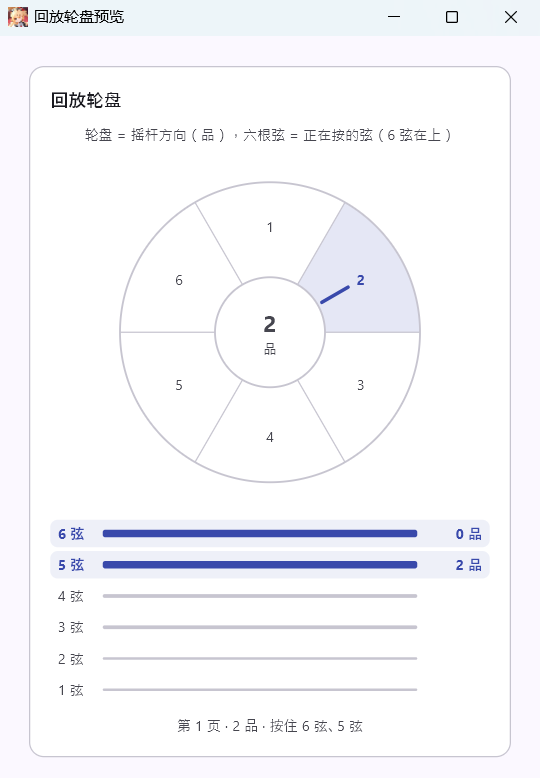

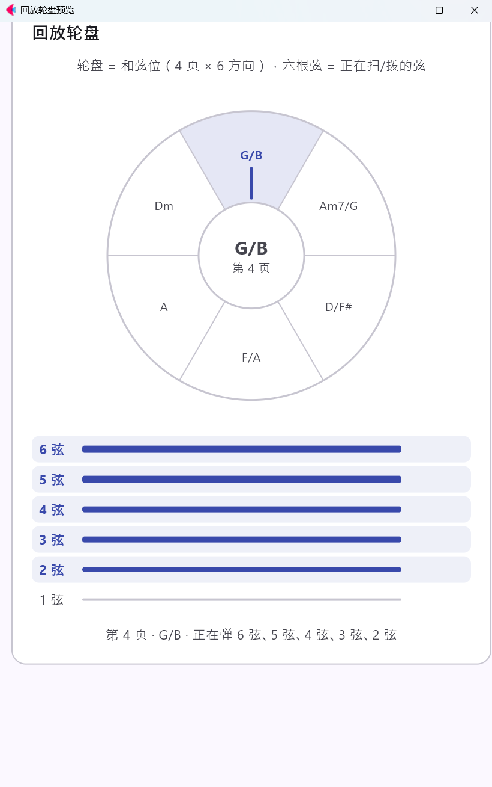

> 这一块原来是手动按键测试面板（X/A/方向键/翻页按钮），按需求换成了轮盘；
> 手动验证可以仍用「载入示例 → 播放」跑一遍。

`build_schedule(doc, tap_notes=True/False, repluck_gap=秒, aim_gap=秒)` 是纯函数，返回
`Schedule(actions, conflicts, hints)`（`conflicts` 是可能弹错的问题，
`hints` 是预期处理），可以直接单测。

## GCT 编辑页

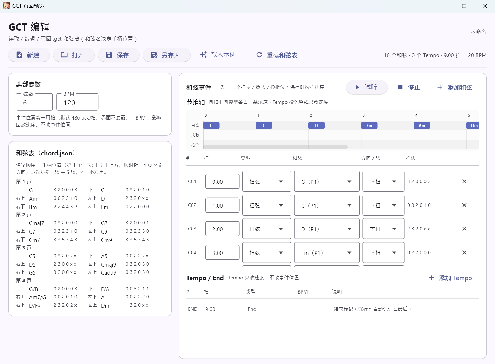

左边是头部参数和和弦表，右边上面是节拍轴、下面是和弦事件列表：

- **头部参数**：弦数、BPM（写进 `default_tempo_us`）；
  事件位置统一用**拍**，时间基准固定 480 tick/拍（和 GTAB 页一样，界面不暴露）；
- **和弦表**：`src/chord.json` 里的 24 个名字按「页 × 方向」排开（第 1 个 = 第 1 页正上方，
  顺时针，4 页 × 6 方向），后面跟 `CHORDS_MAPPINGS` 里的 **6 弦指法**：
  按 **1 弦 → 6 弦** 排列，`-1`（这根弦不发声）显示成 **`x`**，没填指法的显示「未定义」。
  **指法只用于显示/核对，回放位置仍由名字顺序决定**——改指法不会影响手柄排期；
- **节拍轴**：和弦事件按拍画在时间轴上，刻度和 GTAB 页共用一套（`ui/components.py` 的
  `PX_PER_BEAT=120`、每小节 4 拍）；三条泳道分别是**扫弦 / 拨弦 / 指位**，同一拍上
  不同类型的事件不会互相压住。下扫（靛蓝）、上扫（青绿）、拨弦（琥珀）、指位（灰）颜色不同，
  块上写和弦名（拨弦带弦号），悬停看方向 / 弦 / 第几拍；**Tempo 是贯穿泳道的橙色竖线**
  （只标位置，位置本身不受它影响）。改拍、换方向、换和弦时轴立即重画，但**不重建事件行**，
  所以正在输入的拍号框不会失焦；
- **试听**：和弦事件标题栏的「试听 / 停止」按当前谱面合成播放（扫弦六根弦依次响、
  上扫反着来、单弦拨奏只发一根，音高取 `chord.json` 的指法），节拍轴上跟着走一条红色游标；
  没有指法的和弦会跳过并提示。合成规则见下面「和弦谱的试听」；
- **和弦事件**：一条 = 一个 `Strum`（扫弦，可选下扫 / 上扫）/ `Pluck`（单弦拨奏，选 1–6 弦）/
  `Set`（只切指位）；行内可以改拍、类型、和弦，指法列跟着实时更新；
- **Tempo / End**：Tempo 行可以改拍和 BPM（只影响回放速度，不改事件位置）；
  End 只读，保存时自动补在最后（幂等）；
- 保存时按拍排序 + 自动补 End，并回读一遍做严格校验；「另存为」默认 `untitled.gct`。

`chord.json` 是**运行时读取**的：改完 json 不用重启，点工具栏「重载和弦表」
或切回本页（导航切换时自动重读）即可；打开文件前也会重读一次。

## gct 和弦谱（读 + 回放）

`.gct` 是**和弦谱**：事件只说「什么时候弹哪个和弦」，没有 NoteOn/NoteOff、也没有音长。
格式的权威说明在 `src/gct.py` 顶部（头部布局 + 事件类型表 + 扫弦方向），模型在
`src/ui/gct_doc.py`。

- **和弦的位置由名字决定，不由文件里的 chord_id 决定**：`.gct` 自带的和弦表只保证文件内
  引用有效，跨文件稳定的只有名字。`src/chord.json` 里 24 个名字的**顺序就是位置**：
  第 1 个 = 第 1 页正上方，顺时针每 60° 一个，第 7 个 = 第 2 页正上方……
  一共 **4 页 × 6 方向 = 24 个位**。查表在 `src/ui/chords.py`。
- 名字不在 `chord.json` 里的事件会在 ⚠ 冲突里写明并跳过，不会弹成别的和弦。
- 回放规则（`src/ui/gct_backend.py`；翻页 / 摇杆提前量 / 按键推迟复用
  `gamepad_backend.PositionPlanner`，和 gtab 只有一份实现）：
  - 每个和弦事件先翻页（右摇杆向左/向右，推一次一页），把左摇杆提前 `AIM_GAP`
    （默认 65ms）转到和弦位；
  - **扫弦用右摇杆**：向下推 = 下扫、向上推 = 上扫，推到位 `CHORD_STRUM_FLICK=50ms`
    后回中；轮盘上的六根弦按顺序点亮（`CHORD_STRUM_SWEEP=20ms` 一根，比原来逐键按的
    30ms 更快），亮完 `CHORD_LIGHT_HOLD=180ms` 后一起熄灭——**灯只是显示，不发手柄**；
  - **扫弦不再按 6 个弦键**；单弦拨奏（Pluck）才按对应的弦键并按住 `CHORD_HOLD=150ms`；
    只切指位（Set）只摆左摇杆、不出声；
  - **一次扫弦（六根弦依次亮）只计 1 个和弦**（进度文字是「x/y 个和弦」）。
- `.gct` 里没有音长：一个和弦响多久完全由播放器的 `CHORD_HOLD` 决定，文件里查不到，
  也别去文件里找 duration。
- 打开方式：手柄页「打开谱面」按扩展名自动分派 `.gtab` / `.gct`；「示例 gct」在内存里
  生成一张 8 个和弦的示例（走第 1 / 2 / 4 页，含一次上扫和一个 Set），
  如果 `src/MusicList/gctfile/demo.gct` 存在则优先读它。
- 编辑用「GCT 编辑」页（见上）：打开 / 修改 / 保存 `.gct`，左侧和弦表可以核对
  `chord.json` 里的指法（`-1` 显示成 `x`）；和弦谱的时序规则仍以
  `tests/test_gct_mapping.py` 为准（那是可执行文档）。

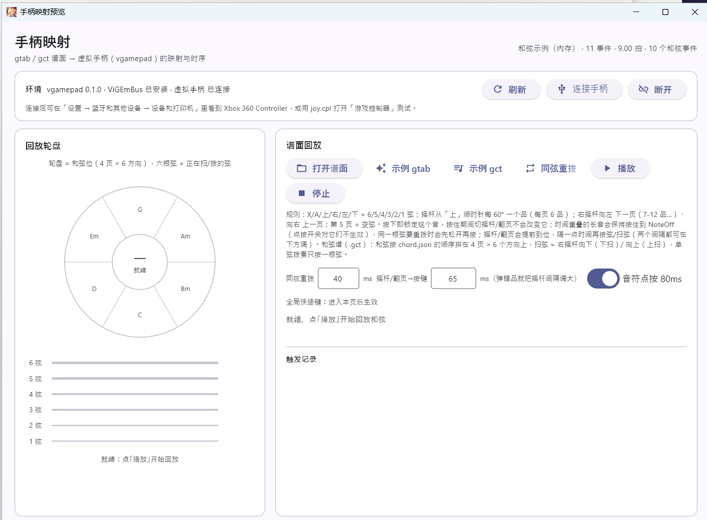

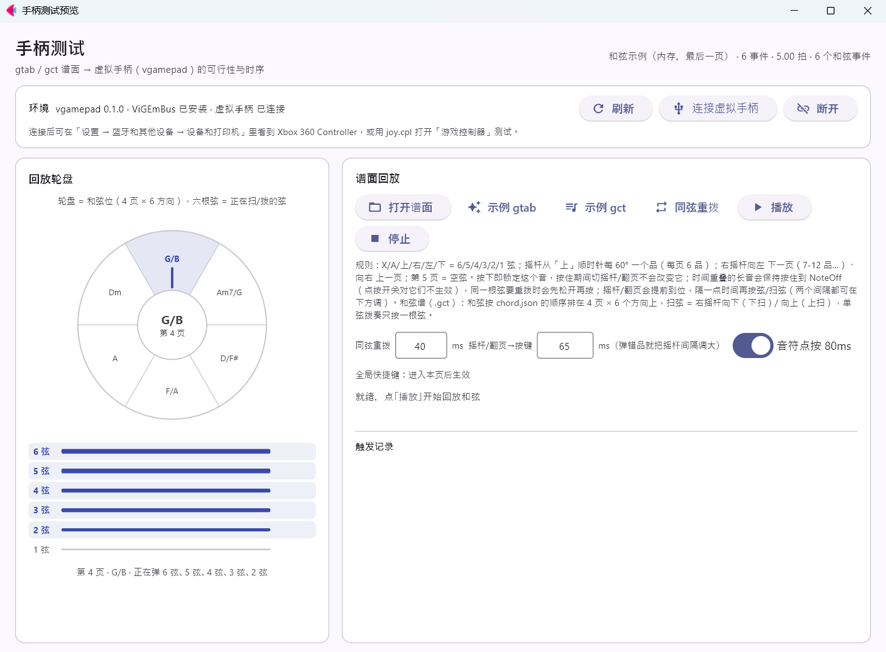

`build_chord_schedule(doc, strum_gap=秒, hold=秒, aim_gap=秒)` 同样是纯函数，
返回 `Schedule(actions, conflicts, hints)`，`unit_label="和弦"`。

## MIDI 映射页（MIDI 文件 → 键盘按键）


给**只认键盘**的游戏用：读标准 MIDI 文件（SMF），把音符按时间映射成按键，
用 Windows `SendInput` 发**扫描码**（很多游戏不认单纯注入的虚拟键，认扫描码）。
这一页是只读的——不编辑 MIDI，只决定「哪个音按哪个键、什么时候按」。

- **键位表** `src/midi_keys.json`（运行时读取，改完点「重载键位」）：
  `BASE_NOTE`（默认 52 = E3）+ 36 个键，从 `BASE_NOTE` 起**每个半音一个键**，
  音域 **E3–D#6**（三个八度），按键盘三行排、每行 12 个半音：
  - 底行 `a s d f g h j k l ; ' enter` = E3–D#4；
  - 中行 `q w e r t y u i o p [ ]` = E4–D#5；
  - 顶行 `1 2 3 4 5 6 7 8 9 0 - =` = E5–D#6。

  `enter` 是唯一允许的**键名**（Enter 没有对应字符），其余必须是单个字符；
  界面上缩写显示成 `Ent`。键位表里不允许出现需要 Shift 的键（如 `!`）；
  页面上的键位表会把**当前谱面用到的键**高亮；
- **超出键位窗口的音**默认**跳过并报出来**（不会静默丢）。**不自动移调**：
  「转换设置」里是一个 **Capo**（0–12 品），N 品 = 整首升高 N 个半音，由你自己选，
  载入新 MIDI 时回到 0；低于 E3 的音不用 Capo 就发不出去；
  设置页打开「MIDI 音域超出后按八度投影」后改为：把每个超窗的音按 ±12 半音移进窗口再发
  （音名会变、节奏不变），Capo 仍在投影之前叠加；
- **点按 / 长按**：默认「点按」每个音只按 `100ms`（大多数键盘游戏在按下那一刻判定）；
  关掉开关则按住到音尾（长按类游戏用）。**同一个键要再按时会先松开至少 `40ms`**，
  否则游戏收不到第二次边沿；
- **时序**：开场 `LEAD_IN=0.4s` 预备；排期与发送都在 `ui/keyboard_backend.py` 里，
  `build_key_schedule(doc, transpose=, tap_notes=, tap_seconds=, project_octave=)` 是纯函数，
  可直接单测（`transpose` 现在就是 Capo 的品位）；
- **节拍轴**：三条泳道 = 键位表的三行（低 / 中 / 高八度），块上写要按的键
  （灰块 = 超出窗口、会被跳过；打开投影后没有灰块，tooltip 里写「八度投影到 X」），
  橙色竖线是 tempo 变化；播放时红色游标**按真实时间推进**——开场静音、音符之间的空隙、
  最后一个音之后的静音收尾都会走，不会只在上一个按键处停住；长谱会自动横向跟随；
- **权限**：`SendInput` 同样受 UIPI 限制，低权限进程（Agent / 沙盒 / CI）发不进权限更高的游戏。
  页面顶部状态卡会用红字写明「低权限运行」；真机请用 `run.bat` / `run_admin.bat` 启动；
- **示例**：点「示例 MIDI」优先读 `src/MusicList/midifile/demo.mid`，文件不存在就用内存里的
  示例（音阶 + 两个三和弦，120 → 180 BPM 变速，用来核对 tempo 换算）；
- 页面底部是**触发记录**：每次按键写出「第几拍 · 音名 → 键」，播完显示按键数与平均/最大误差。

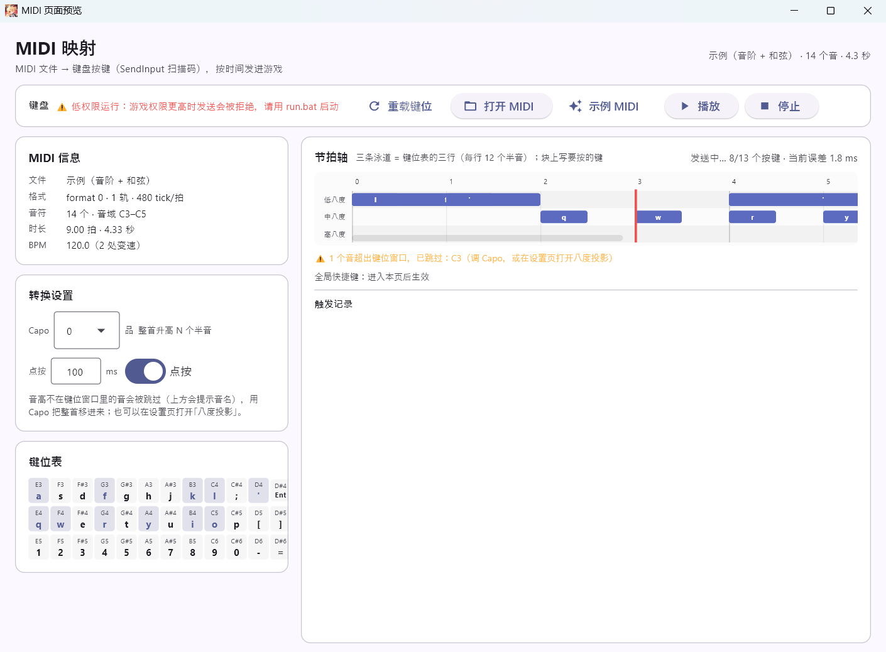

> 与手柄页的区别：手柄页是「谱面 → 虚拟手柄」，MIDI 页是「MIDI → 键盘」，
> 两条路径共用全局热键（F9 / F10）但互不影响；切页会停掉正在发送的按键。

## MIDI→GTAB 页（MIDI 文件 → 可玩的 .gtab）

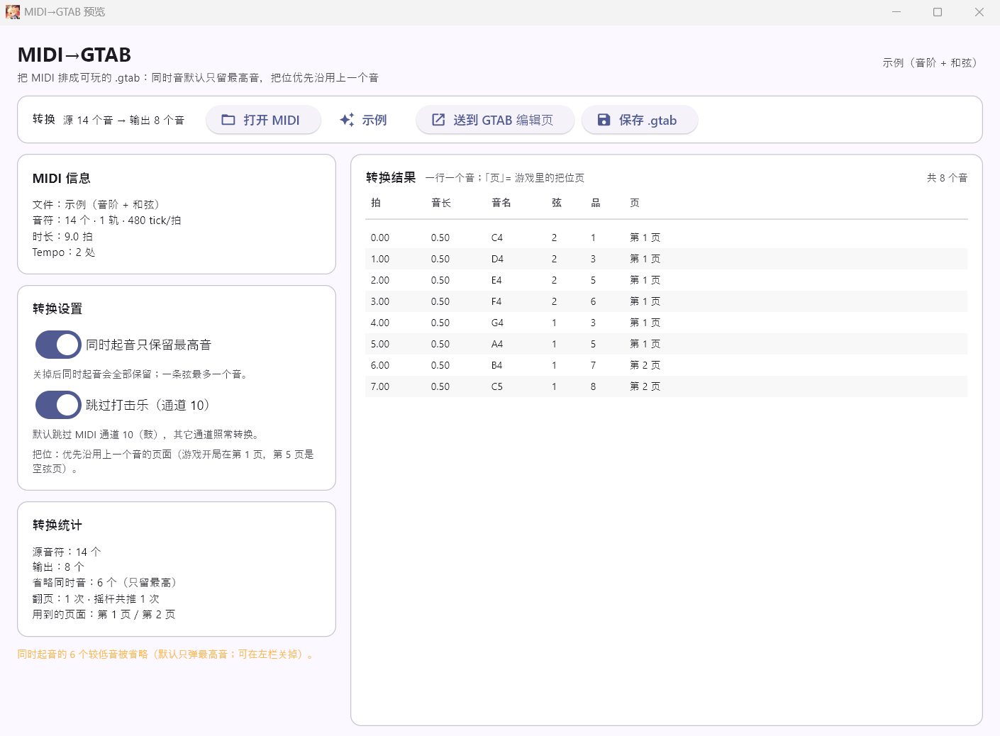

把 MIDI 直接排成手柄能弹的 `.gtab`，和「MIDI 映射」（→ 键盘）是两条不同的路径：

- **定弦**：标准 E2 A2 D3 G3 B3 E4，0–24 品，音域 MIDI 40–88（E2–E6）；
  超出音域的音**跳过并报出数量**（不会静默丢，也不会自动移八度）；
- **同时起音**：同一个 tick 上按下的多个音，**默认只保留最高的那个**（左栏开关可关）。
  关掉后全部保留，最多 6 个（一条弦一个），并尽量让整组落在同一页；
- **打击乐**：MIDI 通道 10（0 基 9，GM 鼓）默认跳过（左栏开关可关），
  避免鼓点被排成低音或噪音；
- **把位（页面）优先沿用上一个音**：游戏每页 6 个品（第 1 页 1–6、第 2 页 7–12、
  第 3 页 13–18、第 4 页 19–24，第 5 页空弦），翻页要推右摇杆、很花时间。
  转换时先按「离上一页最近」选，再避开还按着的弦 / 同弦同品，最后才按「品离上一手近」
  选具体位置；开局按游戏默认的第 1 页算——所以 C4 之后的 E4 会走 2 弦 5 品，
  而不是 1 弦空弦（否则要翻 4 页）；
- **时间轴**：MIDI 的 tick 按 480 tick/拍重新换算，tempo 变化写成 GTAB 的 Tempo 事件，
  音长保留；同弦同品真压在一起时把前一个音截到后一个音的起点（GTAB 不允许同键重叠）；
- **保存 / 送编辑页**：右上「保存 .gtab」直接写文件；「送到 GTAB 编辑页」把结果放进
  GTAB 编辑页（还没落盘，保存时会走「另存为」），可以继续手工改弦 / 品 / 音长；
- 左栏统计给出：源音符数、输出数、省略的同时音、超范围跳过、同键截断、
  翻页次数与摇杆推动次数、用到的页面；右栏预览每个音的拍 / 音长 / 音名 / 弦 / 品 / 页。

> 转换是纯函数（`ui/midi_to_gtab.py` 的 `convert()`），界面只负责选文件 / 显示 / 保存；
> 规则要改都在模型层，`tests/test_midi_to_gtab.py` 可直接跑。

## 设置页

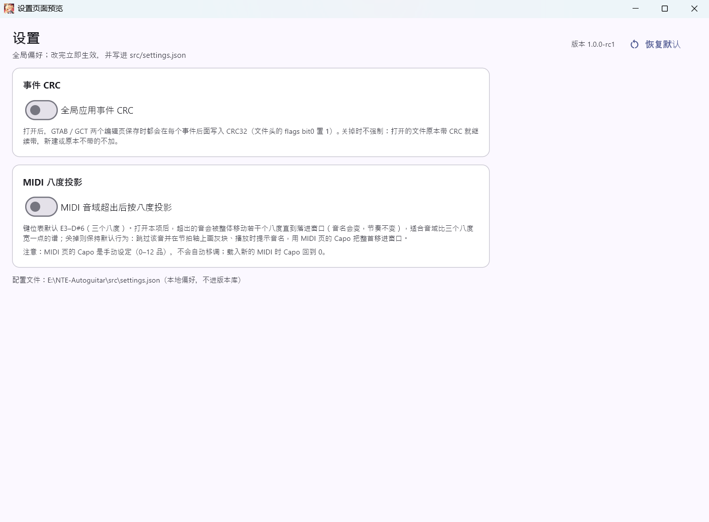

两个**全局**开关，改完立即生效并写盘到 `src/settings.json`（本地偏好，已在 `.gitignore`；
文件不存在 / 坏 JSON / 字段类型不对都按默认值处理，不会让程序起不来）。「恢复默认」
把两个都关掉。右上角显示版本号（`src/version.py` 的 `VERSION`，当前 **1.0.0-rc1**；
rc = 发布候选，改一处版本号即可升到正式版）。窗口/任务栏图标是 `docs/AkaneRin.ico`
（`src/branding.py` 给出路径，Windows 上由 `page.window.icon` 设置）。

- **全局应用事件 CRC**（默认关）：打开后 GTAB / GCT 两个编辑页**保存时一律写入事件 CRC32**
  （文件头 flags bit0）。两个编辑页已**没有**单独的「事件 CRC」开关——这里是唯一控制点；
  关掉时保存不强制（打开的文件原本带 CRC 就继续带，新建或原本不带的不加）。
  代码入口是 `ui/settings.py` 的 `force_event_crc(doc)`，两个页面的保存路径都会先调它。
- **MIDI 音域超出后按八度投影**（默认关）：MIDI 映射页遇到键位窗口外的音时，
  把该音整体移动若干个八度（±12 半音）直到落进窗口再发——**节奏不变、音名会变**；
  关掉则保持默认行为（跳过 + 报出音名 + 节拍轴灰块）。
  MIDI 页的 **Capo** 是手动设定的（0–12 品，载入新 MIDI 时回到 0），**不会自动移调**；
  Capo 在投影之前叠加。

两个开关都只是**存偏好**，不改变文件格式本身；设置页也不负责其它页面的其他参数。

## 测试用全局快捷键

回放测试时游戏要保持焦点，切回本程序点「播放」会让游戏失焦。进入「手柄映射」或
「MIDI 映射」页后，程序会注册 **系统级** 热键（Windows `RegisterHotKey`），
游戏在前台也能触发：

| 热键 | 动作 |
|---|---|
| `F9` | 播放当前谱面 / 开始发送按键（不抢焦点；**不会自动连接手柄**） |
| `F10` | 停止回放 / 停止发送并松开所有键（panic stop） |

- 热键只在「手柄映射」/「MIDI 映射」页激活时注册，切到别的页自动注销，避免长期占用游戏按键；
  两页共用同一组 F9/F10，切页会先注销另一页再注册；
- 键位在 `src/ui/hotkeys.py` 顶部的 `HOTKEY_PLAY` / `HOTKEY_STOP`；
- 如果 `F9` 已被别的软件注册为全局热键，页面会红字提示占用；
  游戏自己用 F9/F10 的话，改上面两个常量即可；
- **必须用普通权限或管理员启动**：低权限（沙盒 / CI / 受限终端）启动的进程是 Low integrity，
  Windows 的 UIPI 会让它在游戏前台收不到全局输入（表现就是「点一下本程序再用热键才行」）。
  双击项目根目录的 `run.bat`；游戏以管理员运行时改用 `run_admin.bat`
  （本次实测：管理员启动后手柄页红字消失、热键正常）；
- 推荐流程：双击 `run.bat` → 载入谱面 → 点一下游戏窗口让它获得焦点 → `F9` 开始 → `F10` 随时停。

## 测试

```powershell
.venv\Scripts\python.exe tests\test_gtab_doc.py
.venv\Scripts\python.exe tests\test_gtab_page.py
.venv\Scripts\python.exe tests\test_audio_preview.py
.venv\Scripts\python.exe tests\test_gamepad_mapping.py
.venv\Scripts\python.exe tests\test_replay_view.py
.venv\Scripts\python.exe tests\test_gct_doc.py
.venv\Scripts\python.exe tests\test_gct_mapping.py
.venv\Scripts\python.exe tests\test_gct_page.py
.venv\Scripts\python.exe tests\test_gct_editor.py
.venv\Scripts\python.exe tests\test_gct_file_ops.py
.venv\Scripts\python.exe tests\test_hotkeys.py
.venv\Scripts\python.exe tests\test_midi_doc.py
.venv\Scripts\python.exe tests\test_midi_to_gtab.py
.venv\Scripts\python.exe tests\test_midi_to_gtab_page.py
.venv\Scripts\python.exe tests\test_settings.py
```

共 240 项（18 / 10 / 14 / 23 / 13 / 11 / 16 / 9 / 30 / 7 / 4 / 31 / 15 / 6 / 33）。

## 打包成 exe（可选）

给不想装 Python 的人用。脚本是 `build_release.ps1`（`flet pack` = PyInstaller）：

```powershell
# 一次性：装打包工具（flet 1.0 的 CLI 是单独的包）
.venv\Scripts\python.exe -m pip install "flet-cli==1.0.4" pyinstaller

# 单文件 → dist\NTE-Autoguitar.exe；加 -OneDir 出文件夹版（启动更快）
pwsh -File build_release.ps1
pwsh -File build_release.ps1 -OneDir

# 启动异常时出带控制台的诊断版（黑窗口里直接看 traceback）
pwsh -File build_release.ps1 -DebugConsole
```

实测产物：单文件约 67 MB；`-OneDir` 是 10 MB 的 exe + `_internal\` 目录。

脚本会先跑 13 个测试（`-SkipTests` 跳过），再按 `src/paths.py` 的资源约定把
`chord.json` / `midi_keys.json` / `MusicList`（示例谱）/ `docs/AkaneRin.ico` 打进包里，
并带上 `vgamepad` 的 `ViGEmClient.dll`。版本号从 `src/version.py` 读。

打包版的行为差异只有一处：**`settings.json` 写到 `%APPDATA%\NTE-Autoguitar\`**
（单文件 exe 的资源目录是临时目录，退出即删），源码运行仍写 `src/settings.json`。

**首次启动**会把内置的 Flet 客户端解包到 `%USERPROFILE%\.flet\client\<版本>-<指纹>\`
（约 200 MB，之后直接复用，所以第一次会慢几秒）。如果这一步被安全软件/权限拦住，
程序会弹「Unhandled exception in script」；用 `-DebugConsole` 版重跑，黑窗口里会显示
`PermissionError` 的具体路径。

发 exe 的发布说明里记得写：**手柄页需要用户机安装 ViGEmBus 驱动**；游戏以管理员运行时
请把 exe 也设为以管理员启动（右键 → 属性 → 兼容性）；PyInstaller 单文件可能被杀软误报，
介意的话发 `-OneDir` 的文件夹版。

## 排错

### 全局快捷键只在点过本程序后有效

如果 `F9` 在本程序窗口获得焦点时才生效、切到游戏就没反应，几乎都是**权限**问题：

Windows 的 UIPI 不允许低权限（Low integrity）进程接收更高权限窗口的键盘输入。
由低权限进程（沙盒终端、CI、部分 IDE 的运行器）启动的程序就是 Low integrity；
用普通终端或下面两个脚本启动则是 Medium：

- `run.bat` — 普通权限启动（游戏也以普通权限运行时用这个）；
- `run_admin.bat` — 以管理员启动（游戏本身是管理员运行时用这个，会弹 UAC）。

「手柄映射」/「MIDI 映射」页的热键提示会红字显示当前是否为低权限。也可以用 PowerShell 确认：

```powershell
whoami /groups | Select-String 'S-1-16-'
```

`S-1-16-4096` = Low，`S-1-16-8192` = Medium。

### 窗口一闪而过 / 程序自己退出

Flet 桌面版是「Python 进程 + flet.exe 客户端」两个进程。flet.exe 一旦崩溃，
Python 端会因为客户端断开而结束，看起来就像"程序自己退了"。

先确认不是代码问题——查事件查看器里有没有 **事件 ID 1000**（应用程序错误）：

```powershell
Get-WinEvent -FilterHashtable @{LogName='Application'; Id=1000; StartTime=(Get-Date).AddHours(-2)} |
  Select-Object TimeCreated, @{n='app';e={ ($_.Message -split "`n")[0] }} | Format-List
```

如果 `出错模块名称` 是 `GPP64.dll`、`RTSSHooks64.dll`、`NahimicOSD.dll` 之类，
说明是第三方**游戏覆盖层 / OSD** 注入到 flet.exe 后访问冲突，与本项目无关。
处理办法：退出该类软件（游戏加加、MSI Afterburner/RivaTuner、Nahimic 等），
或在它们的设置里把 `flet.exe`、`python.exe` 加入「不注入 / 屏蔽」名单。

## License

MIT，见 [LICENSE](LICENSE)。


## 为什么用Flet

好看，我喜欢